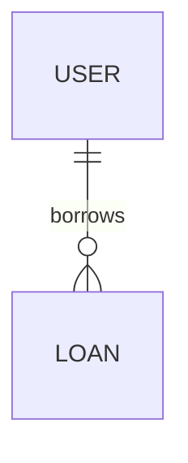

# データ設計: <モジュール名>（BD-xxx）

> 永続データを持つモジュールのみ作成する。
> 設計書にコード（実装コード・擬似コード）は書かない。文章・表・図（Mermaid）で書く。図以外のコードブロックがあると機械チェックが MUST 失敗になる。

## ER 図

## テーブル（エンティティ）

### <テーブル名>

| 列 | 型 | NULL | 既定値 | 制約（PK/FK/UNIQUE/CHECK） | 説明 |
|---|---|---|---|---|---|

- インデックス:
- 機微データの保護（暗号化・マスキング・アクセス制御）:

## 整合性・トランザクション

- 一意性・残高等をどこで守るか（DB 制約 / ロック / トランザクション）:
- 移行（既存データがある場合）:
