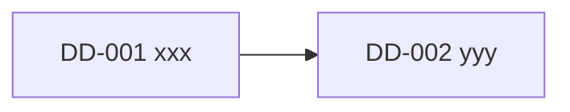
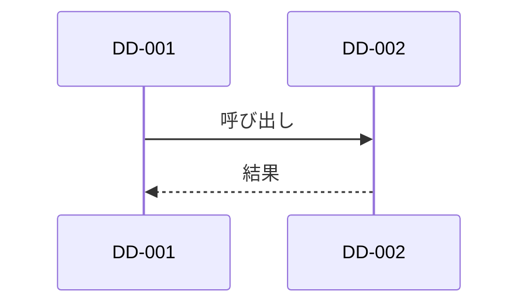
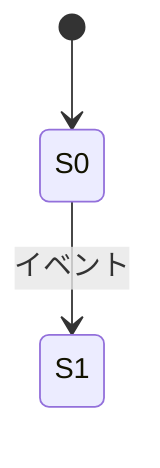

# 詳細設計: <モジュール名>（BD-xxx）

> コード（実装コード・擬似コード）は書かない。処理は文章・表・図で書く。シグネチャは型レベルの定義（表・行内の `code` 表記）まで。
> 図以外のコードブロックがあると機械チェック（scripts/sdlc check）が MUST 失敗になる。
> 該当しない章は削除せず「該当なし」と理由を書く。
> 図は Mermaid で書く。

## 1. 概要

- 目的・スコープ・前提条件:
- 対応する基本設計: BD-xxx（IF-xxx）

## 2. トレーサビリティ

| 上位 ID（SR / BD / IF） | 本書の対応箇所（DD-ID / 章） |
|---|---|
| BD-001 | DD-001（§4.1） |

上位項目で本書がカバーしないものは「対象外」と理由を書く。

## 3. サブ機能の関連

外部（他モジュール・外部システム）との関連もこの図に含める。

## 4. サブ機能の詳細

### DD-001: <関数・クラス・処理名>
- 追跡元: BD-001
- 配置: <src_dir 配下のファイル>
- シグネチャ: `name(arg: 型) -> 戻り型`
- 入力:

| 項目 | 型 | 必須 | 制約 |
|---|---|---|---|
| | | yes | |

- 出力:

| 項目 | 型 | 補足 |
|---|---|---|
| | | |

- 処理:
  1.
- 事前条件 / 事後条件:
- 例外:

| 条件 | 振る舞い | 通知・戻り値 |
|---|---|---|
| | | |

## 5. モジュール内インタフェース

| 提供 → 利用 | シグネチャ | 入力 | 出力 | 処理内容（1〜3 行） |
|---|---|---|---|---|
| DD-001 → DD-002 | | | | |

## 6. シーケンス

正常系に加えて、代表的な異常系（エラー・タイムアウト・リトライ）を 1 つ以上書く。

### 6.1 <パターン名>（正常系）

- リトライ・冪等性・タイムアウト・トランザクション境界:

## 7. 状態遷移

状態を持たない場合は「該当なし（状態は単一）」と書く。

| 状態 | 意味 |
|---|---|
| | |

| 遷移 | イベント | ガード条件 | アクション |
|---|---|---|---|
| S0 → S1 | | | |

- 不変条件（どの状態でも成り立つべきこと）:

## 8. 単体テスト仕様

### UT-001: <テストケース名>
- 追跡元: DD-001
- 入力:
- 期待結果:
- 種別: 正常 | 異常 | 境界
- テストコード: <test_dirs.unit 配下のパス>（コード内に `trace: UT-001`）
