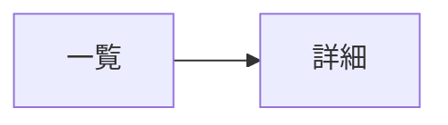

# 画面設計: <モジュール名>（BD-xxx）

> 画面を持つモジュールのみ作成する。

## 画面一覧

| 画面 | 目的 | 対応 DD | 遷移元 → 遷移先 |
|---|---|---|---|

## 画面遷移

## 画面ごとの項目

### <画面名>

| 項目 | 種類（入力/表示/操作） | 型・形式 | 必須 | バリデーション（サーバ側でも検証する） | エラー表示 |
|---|---|---|---|---|---|

- 権限による表示・操作の違い:
- アクセシビリティ上の配慮:
